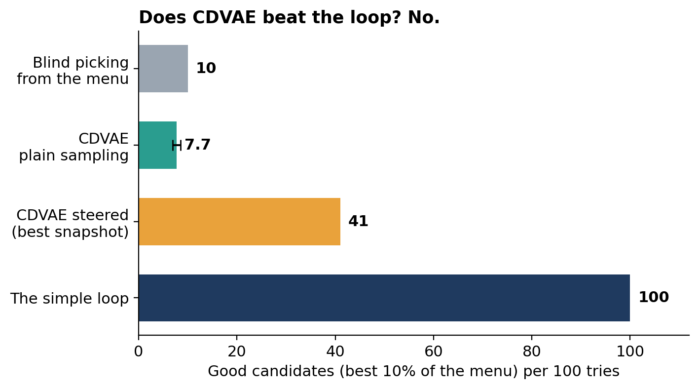
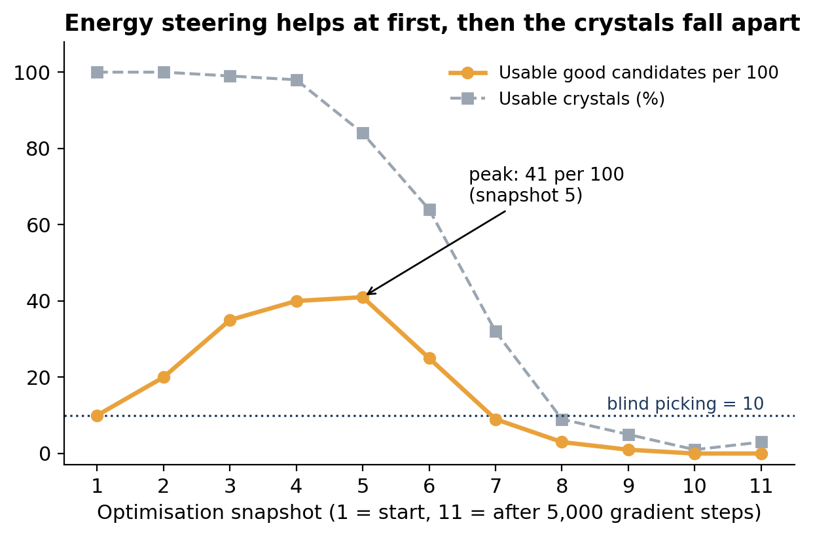
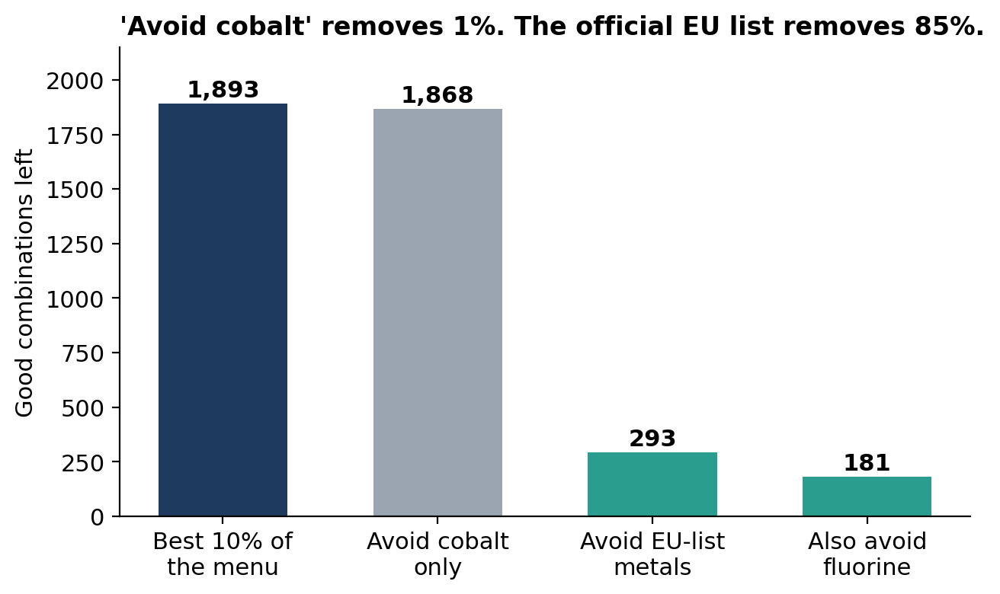

# Does CDVAE beat a simple loop? A fair test on the Perov-5 perovskite dataset

**Short answer: no.** On Perov-5, a loop that takes about 0.01 seconds beats the generative model CDVAE, because the dataset is a *complete menu* of every possible combination and the answers are already in a table.

## Why this project

[CDVAE](https://github.com/txie-93/cdvae) (Xie et al., ICLR 2022) is a well-known generative AI model for crystals. Perov-5 is one of its benchmarks: 18,928 perovskite cells with 5 atoms each. I checked what the dataset really contains and compared the model with the simplest possible method: a loop over every entry.

## What I found

- **The data is a complete menu.** 52 metals (A site) x 52 metals (B site) x 7 anion mixes = 18,928 crystals, each combination exactly once.
- **The standard split leaks.** 59.8% of validation and 58.5% of test crystals share their composition with a training crystal. I built a fair split grouped by composition.
- **The loop wins.** It finds all 1,893 "good" entries (best 10% by energy) in about 0.01 s.
- **CDVAE does not beat it.** Plain sampling gives 7.7% good ones (blind picking gives 10%). Energy steering reaches 41 good ones per 100 at its best snapshot, then the crystals fall apart.
- **"Avoid cobalt" is not a sustainability filter.** It removes 1.3% of the good entries. The official EU list of critical raw materials removes 85%.

| | Simple loop | CDVAE plain sampling | CDVAE energy-steered (best snapshot) |
|---|---|---|---|
| Good ones per 100 tries | 100 | 7.7 (+/- 0.8) | 41 |
| Blind picking, for comparison | 10 | 10 | 10 |
| New things beyond the menu | impossible | 8 of 1,000 (unchecked) | not measured |
| Time | about 0.01 s on a CPU | 0.77 h on a T4 per 1,000 crystals | 0.97 h on a T4 per 1,100 crystals |

## How to reproduce (Google Colab)

1. Open the notebook with the **Open in Colab** button above. Choose Runtime > Change runtime type > **T4 GPU**.
2. Run the cells in order: Cell 1 (get the code), Cell 2 (fair split), Cell 3 (Google Drive and settings), Cell 4 (software environment, about 25 minutes the first time and about 5 minutes when restored from the Drive backup).
3. Run Cell 5, the 3-epoch mini test (about 3 minutes).
4. Run Cell 6 to train (about 3.5 hours on a T4 in total). Progress is saved to Google Drive, so running the cell again resumes training.
5. Run Cell 7 to generate (about 1.7 hours), then Cells 8 and 9 to score the results.
6. Optional: Extra A (the simple loop) and Extra C (EU critical-raw-materials filter) run in seconds.

You need about 5 GB of free space on Google Drive (environment backup, data cache and checkpoints). Free Colab GPU time is limited, so training may take more than one day.

## Repository contents

| File | What it is |
|---|---|
| `CDVAE_Perov5_vs_Loop.ipynb` | The full notebook with outputs |
| `step4_score.py` | The scoring program (the notebook also writes it in Cell 8) |
| `ENVIRONMENT.md` | The exact software versions and why they are pinned |
| `figures/` | The result figures used above |

## Limits

- One model (CDVAE) on one dataset (Perov-5).
- 600 training epochs (the original recipe uses 3,000) and one run, so no spread across random seeds.
- 1,000 plain samples: the hit rate has a noise margin of about 0.8 points. 7.7% is about 2.4 standard errors below 10%, so the safe statement is "no better than blind picking".
- "Good" means low `heat_ref` energy in this dataset. It is a fair yardstick for comparing methods here, not proof of real-world stability.
- The EU list measures supply risk, not toxicity (Cd, Hg, Pb and Tl are not on it). Counting fluorine is a judgement call.
- The 8 off-menu crystals were not checked with an energy model.

## Credits and references

- Xie, T., Fu, X., Ganea, O.-E., Barzilay, R., Jaakkola, T. *Crystal Diffusion Variational Autoencoder for Periodic Material Generation.* ICLR 2022. arXiv:2110.06197. Code: https://github.com/txie-93/cdvae (MIT licence). The notebook downloads it; it is not copied here.
- Castelli, I. E. et al. DFT screening of cubic perovskites, *Energy & Environmental Science*, 2012. This is the source of the Perov-5 data, obtained through the CDVAE repository (not re-uploaded here).
- Martirossyan et al. 2025, arXiv:2509.12178 (the polymorph problem in the standard Perov-5 split).
- Riebesell et al. 2025, Matbench Discovery, *Nature Machine Intelligence*.
- Regulation (EU) 2024/1252 (Critical Raw Materials Act), Annex II.

## Licence

My code and text are released under the MIT licence (see `LICENSE`).
